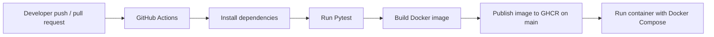

# ShipIt — Containerized Flask App with CI/CD

A small Python web service packaged with Docker and delivered through GitHub Actions.

## Architecture



## Stack
Python 3.12, Flask, Pytest, Docker, Docker Compose, GitHub Actions, GitHub Container Registry.

## 1. Run locally

Prerequisites: Python 3.12+ and Docker Desktop (for container run).

### Run tests without Docker
```bash
python -m venv .venv
# Windows PowerShell:
.venv\Scripts\Activate.ps1
# Linux / macOS:
# source .venv/bin/activate

pip install -r requirements.txt
pip install -r requirements-dev.txt
pytest -v
python app.py
```
Open http://localhost:5000/health

### Run with Docker
```bash
docker build -t shipit-app:local .
docker run --rm -p 5000:5000 shipit-app:local
```
Open http://localhost:5000

### Run with Docker Compose
```bash
docker compose up --build
```
Stop with `Ctrl+C`, then:
```bash
docker compose down
```

## 2. Push to GitHub and enable CI

1. Create a GitHub repository named `shipit-cicd`.
2. From this folder:
```bash
git init
git add .
git commit -m "Build ShipIt CI/CD project"
git branch -M main
git remote add origin https://github.com/YOUR_USERNAME/shipit-cicd.git
git push -u origin main
```
3. Open the repository's **Actions** tab. The `CI` workflow runs on pushes and pull requests. It installs dependencies, runs tests and builds the Docker image.

## 3. Publish image to GHCR

The `Publish Container` workflow runs on pushes to `main`. It uses the automatically provided `GITHUB_TOKEN`; no personal token is required.

1. Ensure repository **Settings → Actions → General → Workflow permissions** allows read and write permissions.
2. Push a commit to `main`.
3. Open **Actions** and confirm `Publish Container` succeeds.
4. The package will appear under your GitHub profile's Packages. If you want to pull it without authentication, change the package visibility to Public in package settings.

Example image name:
`ghcr.io/YOUR_GITHUB_USERNAME/shipit-cicd:latest`

Pull and run (replace username):
```bash
docker pull ghcr.io/YOUR_GITHUB_USERNAME/shipit-cicd:latest
docker run --rm -p 5000:5000 ghcr.io/YOUR_GITHUB_USERNAME/shipit-cicd:latest
```

## 4. What the pipeline does

- `ci.yml`: triggers on pull requests and pushes; sets up Python, installs dependencies, runs Pytest and builds the Docker image.
- `publish.yml`: triggers on pushes to `main`; logs in to GHCR using `GITHUB_TOKEN`, builds and pushes `latest` and commit-SHA tags.
- The app exposes `/` and `/health`; Docker runs as a non-root user and includes a health check.

## Troubleshooting
- If Docker says the daemon is unavailable, start Docker Desktop and wait until it reports that the engine is running.
- If PowerShell blocks venv activation, run `Set-ExecutionPolicy -Scope Process -ExecutionPolicy Bypass`, then activate again.
- If GHCR publishing gets a permission error, check workflow permissions and ensure `packages: write` is present in `publish.yml`.
- Do not put a GitHub PAT in source code or workflow YAML.

## Interview explanation (60–90 seconds)
"I built a small Flask service and packaged it as a Docker image. I added a GitHub Actions CI workflow that runs on pull requests and pushes, installs dependencies, executes Pytest, and verifies the image can build. A separate workflow publishes the image to GitHub Container Registry when code reaches the main branch. I used the built-in GitHub Actions token with package-write permission rather than storing a personal token. The container runs as a non-root user and exposes a health endpoint. I can demonstrate the workflow run, published image and local container."

## Interview questions to prepare
1. **CI vs CD?** CI automatically integrates and validates changes; CD automates delivery/deployment after validation.
2. **Why Docker?** Consistent packaging of app and runtime dependencies across environments.
3. **Why separate CI and publish workflows?** Pull requests should be tested without publishing release images; publishing is limited to main.
4. **What is GHCR?** GitHub's container registry for storing and distributing container images.
5. **What is a tag?** A human-friendly or immutable reference to an image version. This workflow publishes `latest` and the commit SHA.
6. **Why use GITHUB_TOKEN?** A short-lived workflow token with explicitly scoped permissions; avoids hard-coded credentials.
7. **Why non-root?** Reduces container privileges if the application is compromised.
8. **How would you improve this?** Add dependency/image scanning, pinned action versions, semantic version tags, deployment to a managed runtime, environment approvals, and rollback strategy.

## Evidence checklist
- [ ] Local `/health` responds with `{"status":"ok"}`.
- [ ] `pytest -v` passes.
- [ ] Docker image builds and container responds.
- [ ] GitHub Actions CI run is green.
- [ ] GHCR publish workflow is green and image exists.
- [ ] Add screenshots of Actions and package page to the repository README.
